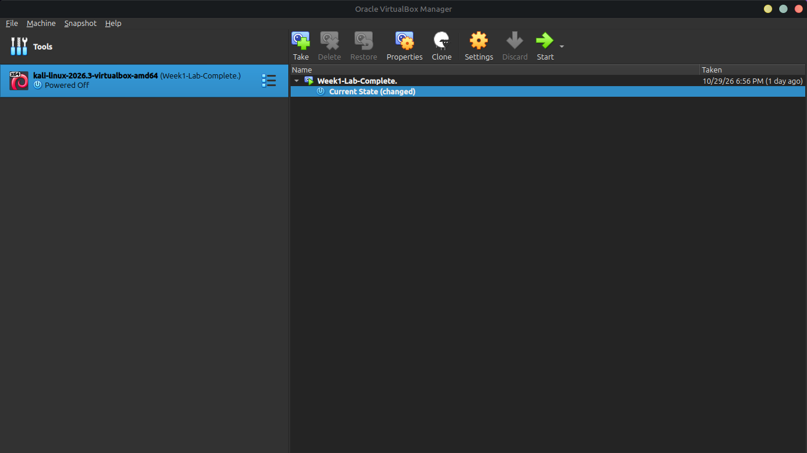

# Networkwalks Cybersecurity Lab - Week 1: Network & VM Setup
**Author:** Farhan Ali Zardari

## 📌 Project Overview
This repository documents the completion of Week 1 for the Networkwalks Cybersecurity program. The lab involved setting up an Oracle VirtualBox environment with Kali Linux, configuring NAT network settings with DHCP, performing connectivity testing, and analyzing live traffic with Wireshark.

---

## ⚙️ Environment Details
- **Hypervisor:** Oracle VirtualBox
- **Guest OS:** Kali Linux (`kali-linux-2026.3-virtualbox-amd64`)
- **Network Configuration:** NAT Network (`NatNetwork`)
- **IP Range:** `10.0.2.0/24` with DHCP Enabled

---

## 📸 Lab Evidence & Verification

### 1. VM Snapshot Verification
Created a system recovery snapshot named `Week1-Lab-Complete.` to preserve the fully configured lab state.

### 2. Network Adapter Configuration
Configured Adapter 1 of the Kali Linux VM to attach to `NAT Network` (`NatNetwork`).

### 3. NAT Network & DHCP Server Settings
Verified the `10.0.2.0/24` subnet prefix and confirmed DHCP server status is active.

### 4. Network Connectivity & Zero Packet Loss Test
Executed `ping -c 4 8.8.8.8` inside Kali Linux terminal. Transmitted 4 packets, received 4 replies with **0% packet loss**.

### 5. Wireshark Packet Capture
Captured live network traffic on interface `eth0`, capturing DHCP Request/ACK packets and ARP resolution traffic.

---

## 🛠️ Troubleshooting & Key Learnings
- **Interface Selection:** During initial packet sniffing in Wireshark, no traffic appeared because the loopback (`lo`) adapter was auto-selected. Switching the active capture adapter to `eth0` resolved the issue and allowed real-time packet inspection.
